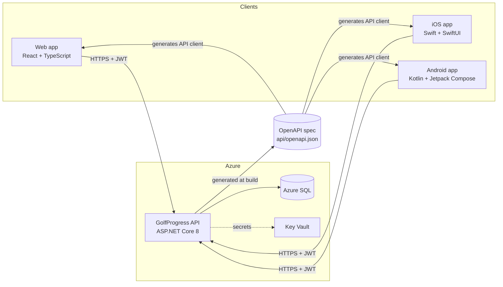
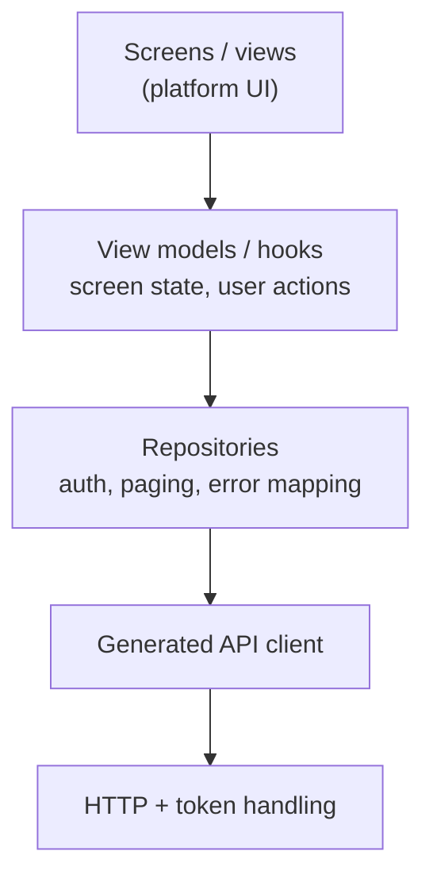

# GolfProgress architecture

GolfProgress helps golfers see progress beyond their score: every round gets a fitness
score built from four pillars (Execution, Damage control, Consistency, Habits), plus
micro-wins, a recommended next focus ("next lever"), and monthly reviews.

So far the product is a back-end API. This document describes the full system: the API
plus three clients, a **web app**, an **iOS app** and an **Android app**, and the
decisions behind it. The screens and navigation are in
[`clients/ux-design.md`](clients/ux-design.md). Deployment configuration is in
[`deployment.md`](deployment.md), and the database model in [`../db/README.md`](../db/README.md).

## System overview



- **One API, three clients.** All business logic (scoring, baselines, micro-wins,
  recommendations) stays in the API. Clients display data and collect input; they never
  compute scores themselves, so all three always agree.
- **The OpenAPI spec is the contract.** The API generates `api/openapi.json` at build
  time, and each client generates its API client from it. The spec is committed, so a
  pull request that changes the API shows exactly how the contract changed.
- **Online-only in v1.** Clients need a connection. Offline round entry is planned as a
  later feature (see [Later](#later-offline-support)); the v1 design keeps it possible.

## Decisions

| Decision | Choice | Why |
|---|---|---|
| Client technology | Native: Swift/SwiftUI (iOS), Kotlin/Jetpack Compose (Android), React + TypeScript (web) | Best platform look, feel and performance, and full access to platform features (Keychain, widgets, health data later). The cost is three UI codebases, which the shared contract and design system keep consistent |
| Repository | Monorepo: API and clients in this repository | One pull request can change the API and its clients together; one issue tracker; no package publishing for shared files |
| Shared code | The OpenAPI spec and the design tokens, not code | The three platforms share no language. Generating clients from one spec removes hand-written API models, the main source of drift |
| Offline | Not in v1 | Keeps the first release small. Every write goes straight to the API |
| Contract changes | Additive only, plus a minimum-version check | Installed mobile apps can't be force-updated, so the API can't break old clients. See [API evolution](#api-evolution) |

## Repository layout

```
/
├── src/                     API (existing): GolfProgress.Api, .Domain, .Infrastructure
├── tests/                   API tests (existing)
├── api/
│   └── openapi.json         Generated API contract, committed
├── clients/
│   ├── web/                 React + TypeScript + Vite
│   ├── ios/                 Xcode project, Swift Package for the API client
│   └── android/             Gradle project
├── design/
│   └── tokens.json          Colours, typography, spacing: one source for all clients
├── db/                      Database scripts and README (existing)
└── docs/                    This documentation
```

CI runs only what a change affects, so a web-only change doesn't trigger an iOS build
(macOS runners cost 10x Linux minutes). `.github/workflows/ci.yml` is the single entry
point: it detects the changed areas (`.github/scripts/changed-areas.sh`), calls each
affected area's workflow, and ends with a **CI result** check that always reports.
That check is the one to require before merging (#59).

| Workflow | Runs on changes to | Runner |
|---|---|---|
| API (`api.yml`) | `src/`, `tests/`, `api/`, the .NET tool and SDK pins | ubuntu |
| Web (`web.yml`) | `clients/web/`, `api/openapi.json`, `design/` | ubuntu |
| Android (`android.yml`) | `clients/android/`, `api/openapi.json`, `design/` | ubuntu |
| iOS (`ios.yml`) | `clients/ios/`, `api/openapi.json`, `design/` | macOS |
| Design (`design.yml`) | `design/` and the generated token files: contrast and drift check | ubuntu |

Changing the CI setup itself, or `.gitattributes`, runs every area. Documentation-only
changes run none, and still get a passing **CI result**.

## The API contract

### Generating the spec

The API already uses Swashbuckle, but only serves Swagger UI in Development. The spec
becomes a build output instead:

1. The API build writes `api/openapi.json` (Swashbuckle CLI, or
   `Microsoft.Extensions.ApiDescription.Server`).
2. CI regenerates it and **fails if the committed file differs**, so the spec can't drift
   from the code.
3. Endpoints declare their response types and status codes
   (`[ProducesResponseType]`), errors as `ProblemDetails`, the bearer-token scheme, and
   response headers such as `X-Total-Count`. Without these the generated clients are
   untyped.

### Generated clients

| Client | Generator | Runtime |
|---|---|---|
| Web | `openapi-typescript` (types) + `openapi-fetch` | `fetch` |
| iOS | Apple's `swift-openapi-generator` (Swift Package plugin) | `URLSession` transport |
| Android | OpenAPI Generator, `kotlin` generator with `jvm-retrofit2` + `kotlinx_serialization` | Retrofit + OkHttp |

Generated code isn't edited by hand. Each client wraps it in a small repository layer of
its own, which is where token refresh, error mapping and paging live.

### API evolution

Mobile users don't all update, so several app versions are live at once:

- **Additive changes only:** new endpoints and new optional fields. Removing or renaming
  fields, or changing their meaning, isn't allowed.
- **New values in response enums** depend on whether the field is open or closed (#134).
  The generated iOS and Android clients turn a closed enum into a closed type, and fail
  to read a whole response containing a value they don't know.
  - **Open** fields may gain values at any time: `PracticeSessionResponse.sessionType`,
    `MicroWinResponse.category` and `RoundResponse.source`. The spec publishes them as
    plain strings, with the current values in `x-known-values`. Each client maps them to
    its own type with an "unknown" fallback, which the UI shows as something generic.
  - **Closed** fields are everything else (`units`, `trackingMode`, `confidenceLevel`,
    micro-win `direction`, ...): stable sets, typed directly. Adding a value to one is a
    breaking change. Raise the minimum app versions first, or add a new field.
  - **Request** enums stay closed: an app only sends values it knows.
- **Breaking change needed?** Add a new endpoint next to the old one, and remove the old
  one only once no supported app version uses it.
- **Minimum version:** `GET /client-config` returns the minimum supported version per
  platform. Apps below it show an "update required" screen instead of failing in
  unpredictable ways.

## API changes the clients need

The current API was built for a single trusted client. Before the clients can ship, it
needs:

| Change | Why |
|---|---|
| Score a round when it's logged | Today a client must call `POST /me/rounds`, then `compute`, `micro-wins/generate` and `next-lever`: four round-trips, which every client would have to orchestrate. Logging a round should do this in one request |
| `PUT` / `DELETE /rounds/{id}` | Users mistype scores. Editing must recompute the score and baseline |
| `PATCH /me` | Display name, units, tracking mode, goal focus, handicap |
| `POST /me/password` | Change password; revokes other sessions' refresh tokens |
| Password reset by email | Users forget passwords. Needs an email provider (new infrastructure) |
| `DELETE /me` | **Required by the App Store and Google Play:** apps that create accounts must let users delete them in-app |
| Refresh-token cookie for web | Browsers shouldn't keep a long-lived refresh token where JavaScript can read it (see [Authentication](#authentication)) |
| `GET /client-config` | Minimum supported app versions |
| Review per-IP rate limits | Mobile carriers put many users behind one IP (carrier-grade NAT); 10 auth requests per minute per IP may block real users |

## Authentication

The API issues a short-lived **access token** (JWT, 15 minutes) and a long-lived
**refresh token** (14 days, rotated on every use, stored only as a hash).

| | Access token | Refresh token |
|---|---|---|
| Web | In memory only | `HttpOnly`, `Secure`, `SameSite=Strict` cookie scoped to `/auth`, so script can't read it |
| iOS | In memory | Keychain (`kSecAttrAccessibleAfterFirstUnlockThisDeviceOnly`) |
| Android | In memory | Encrypted with an Android Keystore key, stored in DataStore |

**How the web app gets its cookie (#68).**
- **Opting in:** the web client sends `X-Refresh-Token-Mode: cookie` on register, login and
  refresh. The refresh token then arrives as the `gp_refresh` cookie (`HttpOnly`, `Secure`,
  `SameSite=Strict`, `Path=/auth`), and the body's `refreshToken` is `null`.
- **Using it:** `/auth/refresh` and `/auth/logout` read the cookie when the body has no
  token, so the web client sends an empty body. Logout clears the cookie.
- **Hosting:** the web app and the API are served from **the same site**, as sibling
  subdomains (for example `app.example.com` and `api.example.com`). A `SameSite=Strict`
  cookie therefore still reaches the API, while no other site can make a browser send it.
- **CORS:** requests from the web app are still cross-origin, so they need CORS with
  credentials. That's allowed **only on `/auth/*`**, and only for the origins in
  `Cors:AllowedOrigins`. The rest of the API is authorised by the bearer token and never
  accepts credentials.
- **Calling the API:** the web client sends `/auth/*` requests with
  `credentials: "include"`.

Every client follows the same flow: send the access token as `Authorization: Bearer`; on
a `401`, refresh once, retry the request, and go to the login screen if refreshing fails.
Concurrent requests share one refresh rather than each starting their own.

## Client architecture

All three clients use the same layering, so a feature looks alike on every platform:



| | Web | iOS | Android |
|---|---|---|---|
| Language / UI | TypeScript, React 18, Vite | Swift 6, SwiftUI | Kotlin, Jetpack Compose, Material 3 |
| Minimum version | Last 2 versions of evergreen browsers | iOS 17 | Android 8.0 (API 26) |
| State | TanStack Query (server state), React state | `@Observable` view models | `ViewModel` + `StateFlow` |
| Navigation | React Router | `NavigationStack` + `TabView` | Navigation Compose |
| Dependency injection | Module imports | Initializer injection | Hilt |
| Charts | Recharts | Swift Charts | Vico |
| Tests | Vitest + Testing Library; Playwright end-to-end | Swift Testing; XCUITest | JUnit; Compose UI tests |
| Distribution | Azure Static Web Apps | TestFlight, then the App Store | Play internal testing, then Play |

### Errors

The API returns `ProblemDetails` for every error. Clients map them consistently:

| Status | Client behaviour |
|---|---|
| `400` with `errors` | Show each message next to its field. Clients also validate locally with the same rules, but the API stays the authority |
| `401` | Refresh and retry once, otherwise sign out |
| `404` | "Not found" state; the item may have been deleted on another device |
| `429` | Wait for `Retry-After`, then tell the user to try again |
| `5xx` / no network | Generic error with retry. Show the `traceId` in debug builds only |

### Paging

List endpoints take `skip` and `take` and return the total in `X-Total-Count`. Clients
load pages on scroll (infinite list) and stop at the total.

## Design system

`design/tokens.json` holds colours (including one colour per score pillar), typography
scale, spacing and corner radii. Each platform turns it into native constants: CSS
variables on the web, a Swift `enum` on iOS, a Compose theme on Android. Screens use only
tokens, never literal colours or sizes, so all three apps stay visually consistent and
support dark mode from day one.

Accessibility is part of "done" for every screen: WCAG 2.1 AA contrast, Dynamic Type and
font scaling, VoiceOver and TalkBack labels (including for charts), and touch targets of
at least 44×44 pt / 48×48 dp. All user-facing text goes through each platform's
localisation system from the start, English first.

## Observability and privacy

- **Crash and error reporting** in each client, sending no personal data. The `traceId`
  of failed requests is attached, so a client error can be matched to the API's logs.
- **API telemetry** through Application Insights.
- **Privacy:** both stores require a privacy policy and a data declaration (App Store
  privacy labels, Google Play data safety form). The app stores golf statistics and an
  email address, has no ads, and does no tracking.

## Delivery phases

The GitHub milestones follow these phases:

| Milestone | Goal |
|---|---|
| **M1 Foundation** | Repository structure, OpenAPI spec and generated clients, CI per area, design tokens, and an app shell on each platform where a user can sign in |
| **M2 MVP** | The core features on all three clients, and the API changes they need |
| **M3 Beta** | Web on staging, TestFlight and Play internal testing; crash reporting, accessibility pass, privacy policy, password reset |
| **M4 Launch** | Store listings, store review, production release |
| **Later** | Offline support, push notifications, and more |

## Later: offline support

Not in v1, but v1 keeps it possible:

- Offline sync will need `POST /me/rounds` to accept an optional, client-generated round
  id (a UUID) and treat a repeat as the same round, so a retried upload can't create a
  duplicate. Today the API generates the id; this is an additive change for the offline
  feature.
- Writes go through the repository layer, where a local queue can be added without
  changing the screens.
- The API's validation and scoring are already deterministic, so a round synced late
  scores the same as one sent immediately.
